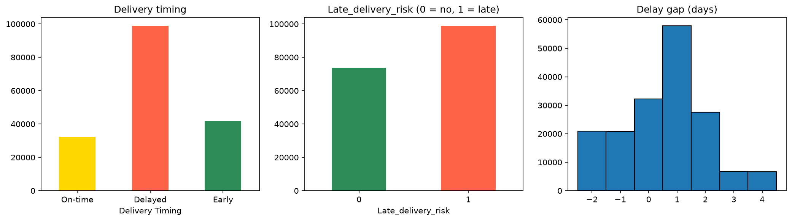
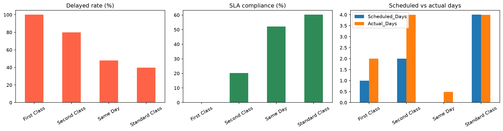
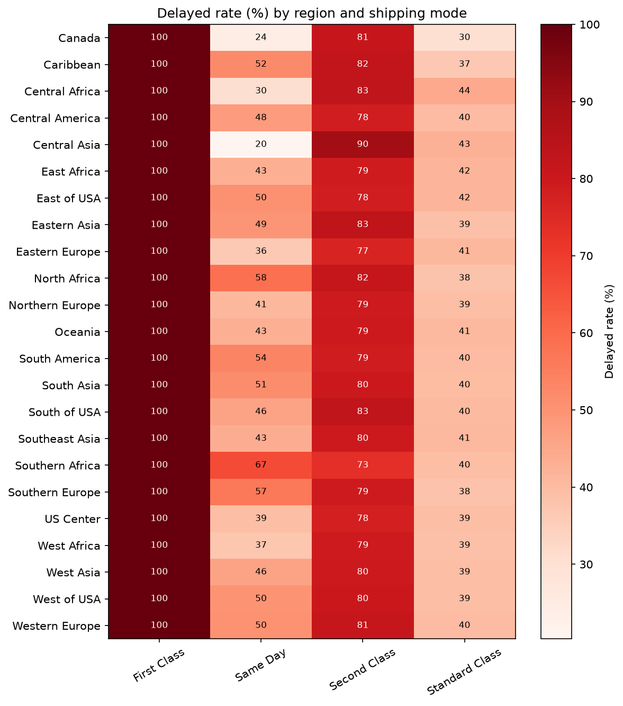
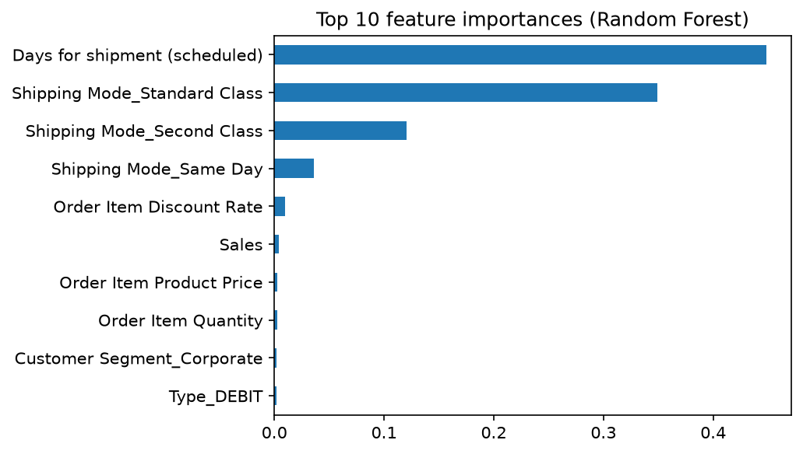

# APL Logistics — Delivery Performance Analysis & Prediction

An end-to-end data science project that analyses **170 000+** supply-chain orders, uncovers what drives late deliveries, and serves an interactive **Streamlit dashboard** with a built-in **ML prediction** tool.

---

## Table of Contents

- [Overview](#overview)
- [Project Structure](#project-structure)
- [Key Findings](#key-findings)
- [Models](#models)
- [Getting Started](#getting-started)
  - [Prerequisites](#prerequisites)
  - [Installation](#installation)
  - [Running the Dashboard](#running-the-dashboard)
  - [Running the Notebook](#running-the-notebook)
- [Dashboard Features](#dashboard-features)
- [Dataset](#dataset)
- [Screenshots](#screenshots)
- [License](#license)

---

## Overview

APL Logistics is a global supply-chain dataset containing order, shipping, customer, and product information. This project:

1. **Cleans & validates** the raw data (duplicates, missing values, text normalisation).
2. **Explores** delivery timing, shipping modes, regions, markets, and customer segments.
3. **Trains two ML models** (Logistic Regression & Random Forest) to predict late-delivery risk *before* an order ships.
4. **Deploys** everything in a Streamlit web app with interactive filters, KPIs, charts, heatmaps, and a one-click prediction page.

---

## Project Structure

```
APL_Logistics_Project/
├── app.py                              # Streamlit dashboard application
├── APL_Logistics_Project.ipynb         # Jupyter notebook (full EDA + model training)
├── requirements.txt                    # Python dependencies
├── .gitignore                          # Git ignore rules
├── README.md                           # This file
│
├── data/
│   ├── raw/
│   │   └── APL_Logistics.csv           # Original dataset (~62 MB)
│   └── processed/
│       └── APL_Logistics_cleaned.csv   # Cleaned dataset (output of notebook)
│
├── models/
│   ├── logistic_regression.joblib      # Trained Logistic Regression model
│   ├── random_forest.joblib            # Trained Random Forest model
│   ├── scaler.joblib                   # StandardScaler fitted on training set
│   ├── feature_columns.joblib          # Feature column names after one-hot encoding
│   └── model_results.csv              # Model evaluation metrics
│
└── outputs/
    ├── figures/
    │   ├── 01_delivery_overview.png
    │   ├── 02_shipping_mode_efficiency.png
    │   ├── 03_heatmap_region_vs_shipping_mode.png
    │   ├── 04_heatmap_market_vs_shipping_mode.png
    │   ├── 05_confusion_matrix_random_forest.png
    │   └── 06_feature_importance_random_forest.png
    │
    └── tables/
        ├── shipping_mode_summary.csv
        ├── regional_summary.csv
        ├── market_summary.csv
        └── customer_segment_summary.csv
```

---

## Key Findings

| Insight | Detail |
|---|---|
| **Overall delayed rate** | ~57 % of delivered orders arrive later than scheduled |
| **Shipping mode is the #1 driver** | First Class = 100 % delayed, Standard Class = 40 % delayed |
| **Region has minimal independent effect** | Delayed rates range only 52–60 % across 23 regions after controlling for shipping-mode mix |
| **Customer segment is neutral** | Consumer, Corporate, and Home Office all sit near 57 % delayed |
| **ML barely beats a simple rule** | A "predict late if First/Second Class" rule achieves ROC AUC 0.74, nearly matching both models |

---

## Models

| Model | Accuracy | Precision | Recall | F1 | ROC AUC |
|---|---|---|---|---|---|
| Logistic Regression | 0.6966 | 0.8834 | 0.5418 | 0.6717 | 0.7445 |
| Random Forest | 0.6956 | 0.8335 | 0.5858 | 0.6880 | 0.7458 |
| Shipping-mode rule (baseline) | 0.6968 | 0.8864 | 0.5398 | 0.6710 | 0.7419 |

> **Note:** Features used for prediction are limited to information available *before* shipping (payment type, shipping mode, scheduled days, market, region, customer segment, product category, quantity, discount, price). Post-delivery fields like actual shipping days, delivery status, and delay gap are excluded to avoid data leakage.

---

## Getting Started

### Prerequisites

- Python 3.9 or later
- `pip` package manager

### Installation

```bash
# Clone the repository
git clone https://github.com/<your-username>/APL_Logistics_Project.git
cd APL_Logistics_Project

# Create a virtual environment (recommended)
python -m venv venv
source venv/bin/activate        # Linux / macOS
venv\Scripts\activate           # Windows

# Install dependencies
pip install -r requirements.txt
```

### Running the Dashboard

```bash
streamlit run app.py
```

The app opens at **http://localhost:8501**. You can either:
- Place `APL_Logistics.csv` in `data/raw/` (the app reads it automatically), or
- Upload it via the sidebar file uploader.

If the pre-trained models in `models/` are present the app uses them directly. Otherwise it trains new models on the fly (takes ~10 s on the first load).

### Running the Notebook

```bash
jupyter notebook APL_Logistics_Project.ipynb
```

Run all cells to reproduce the full analysis — data cleaning, EDA, model training, figure export, and CSV exports.

---

## Dashboard Features

### 📊 Dashboard Page
- **KPI cards** — total orders, on-time rate, delayed rate, average delay gap, late-risk ratio
- **Delivery timing bar chart** and **delay-gap histogram**
- **Shipping mode comparison** — delayed rate, SLA compliance, scheduled vs actual days
- **Regional & market analysis** — tables, bar charts, and a heatmap of delayed rate by region × shipping mode
- **Country-level drill-down** (top 10 countries by delayed rate, min 100 orders)
- **Customer segment impact** — share of orders vs share of late orders
- **Delivery status details** and **filtered CSV download**
- **Sidebar filters** — shipping mode, region, market, customer segment, date range

### 🔮 Delay Prediction Page
- Choose **Logistic Regression** or **Random Forest**
- Enter order details (shipping mode, market, region, segment, category, quantity, discount, price)
- Get a **probability of late delivery** with a progress bar and label
- View **model comparison metrics** (Accuracy, Precision, Recall, F1, ROC AUC)

---

## Dataset

The dataset contains **~180 000 rows** and **39 columns** covering:

| Column Group | Examples |
|---|---|
| **Shipping** | `Shipping Mode`, `Days for shipping (real)`, `Days for shipment (scheduled)` |
| **Order** | `Order Region`, `Order Country`, `Market`, `Order Status`, `Delivery Status` |
| **Customer** | `Customer Segment`, `Customer City`, `Customer Country` |
| **Product** | `Category Name`, `Department Name`, `Product Price` |
| **Financials** | `Sales`, `Order Profit Per Order`, `Order Item Discount Rate` |
| **Target** | `Late_delivery_risk` (binary: 0 = on time, 1 = late) |

---

## Screenshots

| Delivery Overview | Shipping Mode Efficiency |
|---|---|
|  |  |

| Region × Shipping Heatmap | Feature Importance |
|---|---|
|  |  |

---

## License

This project is provided for educational and analytical purposes. The dataset is sourced from public supply-chain data.
